

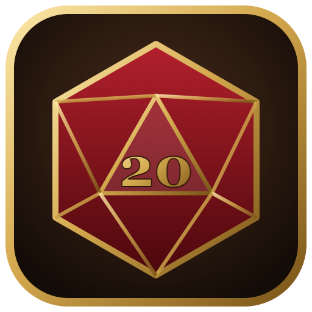

# GRIMORIO

### Tu mesa de rol: fichas que se calculan solas, dados 3D y partidas online con tu grupo.

**Mundo de Tinieblas (Vampiro · Hombre Lobo · Mago) · Dungeons & Dragons (5ª · 5.5 · 3.5)**

<a href="https://jesusjacky.github.io/Grimorio-descargas/">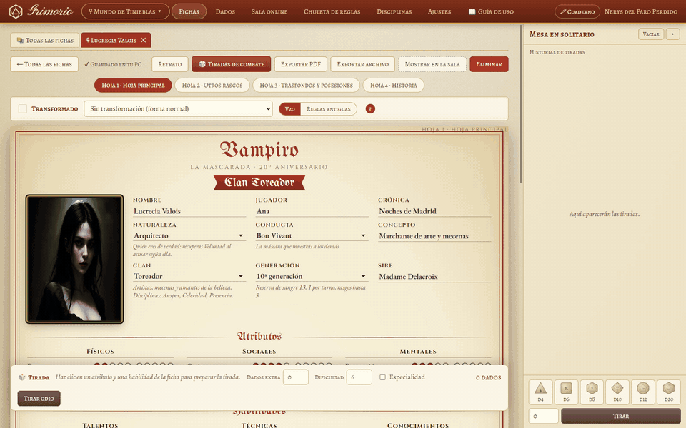</a>

---

## 📜 ¿Qué es?

¿Fichas de papel llenas de borrones? ¿Media partida sumando bonificadores? ¿Un amigo jugando desde otra ciudad y otro que siempre olvida sus dados?

**Grimorio** es tu mesa de rol en el ordenador (y en el móvil). Creas las fichas de tus personajes **como en papel**, pero se rellenan y se calculan solas; tiras los dados en **3D**, en grande, en el centro de la pantalla; y juegas **online con tu grupo** con un simple código de 6 letras. Todo en castellano, gratis y sin cuentas.

<table>
<tr>
<td width="50%" valign="top">

### 🩸 Fichas como las de papel… pero que piensan
Elige el clan, la tribu o la tradición y Grimorio completa lo que marca el libro: disciplinas, debilidad, reserva de sangre… Marca los puntos con un clic, ponle un **retrato** (de la galería o creado con IA) y llévatela en **PDF**. Puedes tener varias fichas abiertas en pestañas.

</td>
<td width="50%"></td>
</tr>
<tr>
<td width="50%">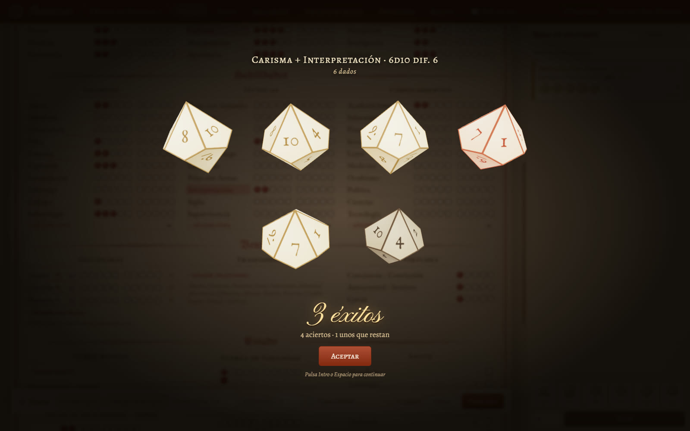</td>
<td width="50%" valign="top">

### 🎲 Dados 3D que ruedan en grande
Haz clic en un atributo y una habilidad (por ejemplo, **Carisma + Interpretación**) y la reserva se prepara sola, con la dificultad y las heridas. Los dados ruedan en el centro de la pantalla y el resultado se queda hasta que pulsas **Aceptar**: éxitos, unos que restan, fracasos… Y en el historial puedes girar cualquier dado en 3D.

</td>
</tr>
<tr>
<td width="50%" valign="top">

### 🐺 Transfórmate
¿Tu garou pasa a **Crinos**? ¿Tu vampiro usa la **Forma Horrenda**? Elige la transformación y verás cómo es, con su ilustración, qué da, qué quita y cuánto dura. Al marcar **Transformado**, la ficha y las tiradas cambian solas: los puntos ganados salen **dorados** y los perdidos, **tachados**. Al volver, todo queda como estaba.

</td>
<td width="50%">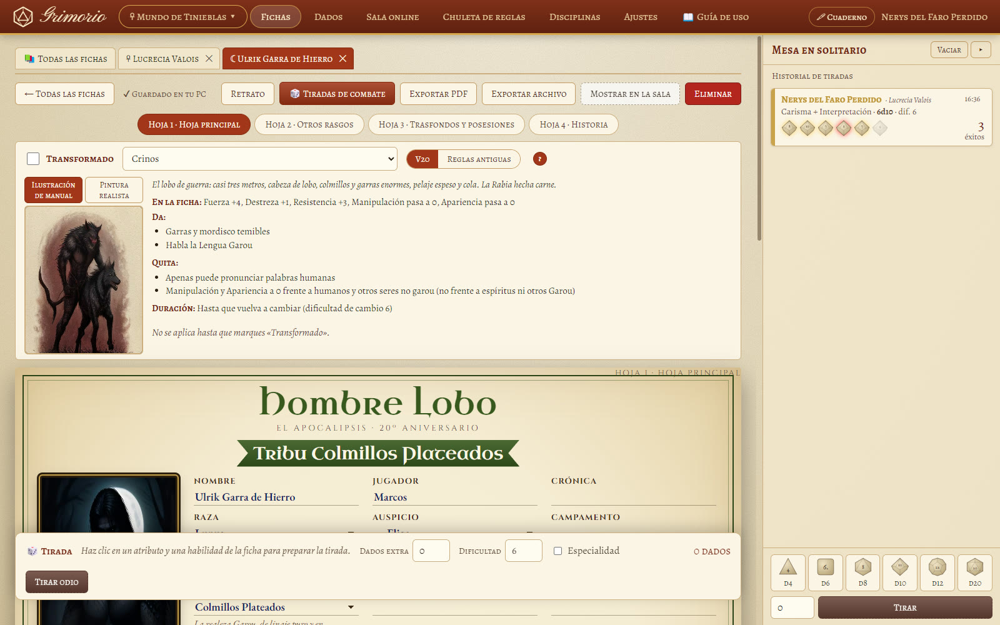</td>
</tr>
<tr>
<td width="50%">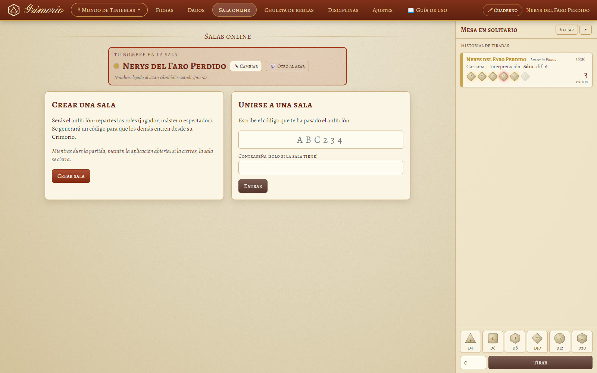</td>
<td width="50%" valign="top">

### 🌐 Juega online con tu grupo
Uno crea la sala, elige el juego y sus reglas, y pasa un **código de 6 letras**. Sin servidores que montar ni cuentas que crear: os conectáis directamente entre vosotros. Hay **roles** (máster, jugador, espectador), tiradas **públicas, privadas u ocultas**, **iniciativa** automática, **mapa táctico** y fichas compartidas que el máster puede revisar. Con contraseña y aprobación de entradas, si queréis.

</td>
</tr>
</table>

## 🐉 Dungeons & Dragons

Fichas de la **5ª edición (2014)**, la **5.5 (2024)** y la **3.5**. Escribe tus puntuaciones y Grimorio calcula **todo lo demás**: CA, iniciativa, puntos de golpe, salvaciones, habilidades, ataques, espacios de conjuro… Y si pasas el ratón por cualquier número, te dice **de dónde sale cada punto**.

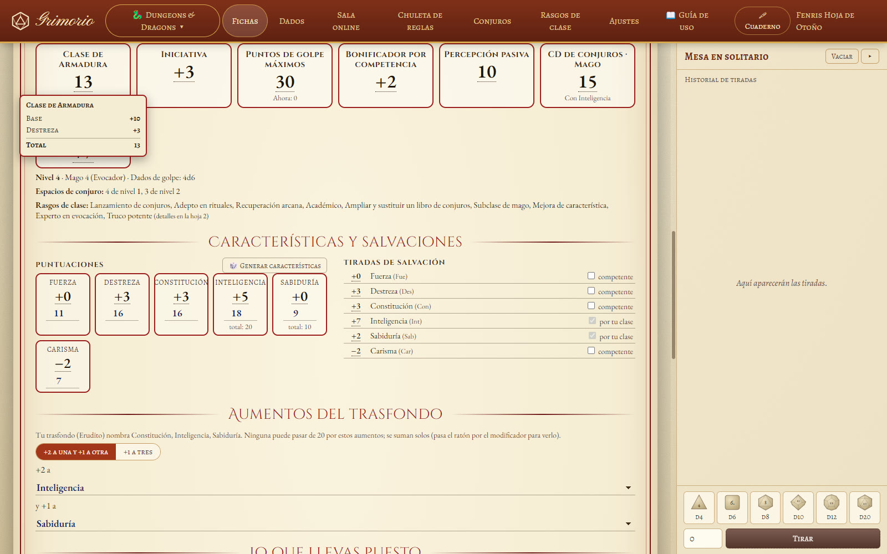
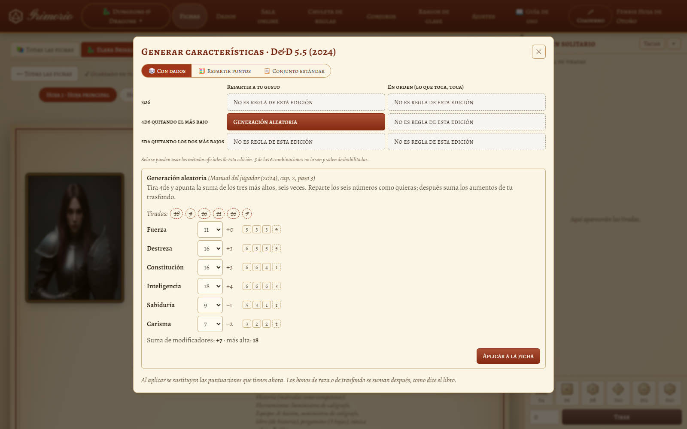

- **🎲 Generar características** con los métodos de cada edición (4d6 quitando el más bajo, 3d6, 5d6…), repartiendo o en orden, o **repartiendo puntos**.
- **Multiclase** con el registro de cada nivel y su tirada de puntos de golpe.
- **Equipo mágico** (+1, sagrada, +1d6 de frío…) que se suma solo, **dotes**, **compañeros animales** e **invocaciones**.
- **Tiradas de combate** con el arma elegida: ataque y daño, con críticos según tu edición, y **ventaja o desventaja**.
- Ambientación **Reinos Olvidados** (en 5ª y 3.5), con sus dioses, razas y opciones propias.

## 🎨 A tu estilo

Tres estilos para toda la aplicación (**manuscrito**, **taberna** y **bosque**) y **21 diseños de dados**, de «Sangre de Caín» a «Escamas de dragón». En una sala, los demás ven tus dados con tu diseño.

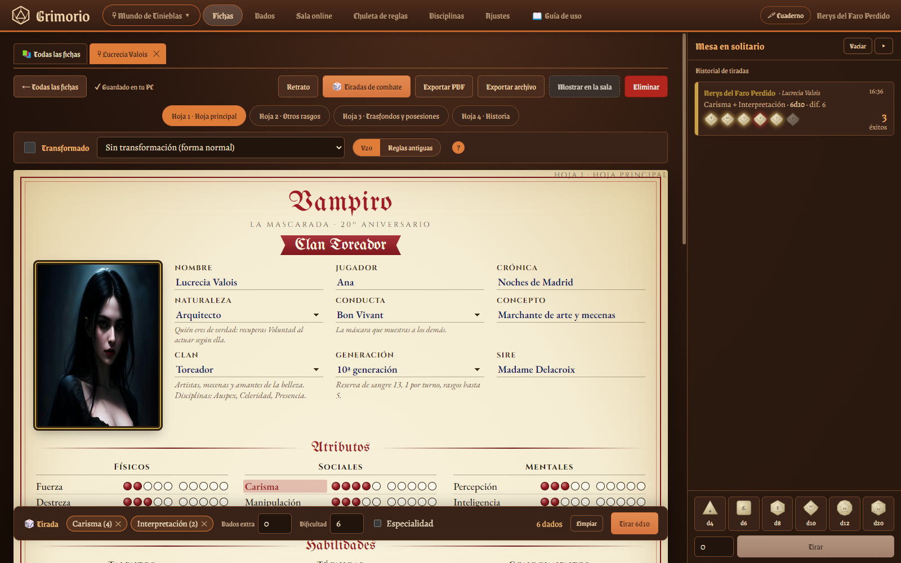
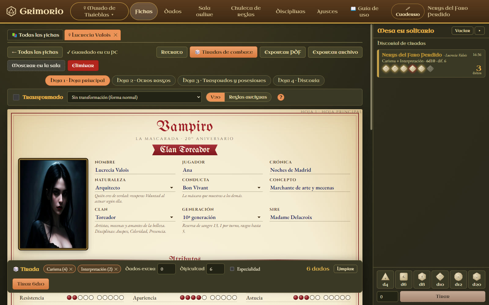

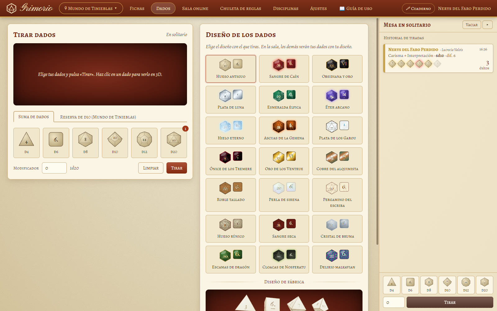

## 📚 Las reglas, a un clic

Una **chuleta de reglas** por secciones con buscador, todas las **disciplinas** de Vampiro (con los poderes combinados) y, en D&D, los **conjuros** y los **rasgos de clase** de cada edición. Donde las ediciones no coinciden, lo verás.

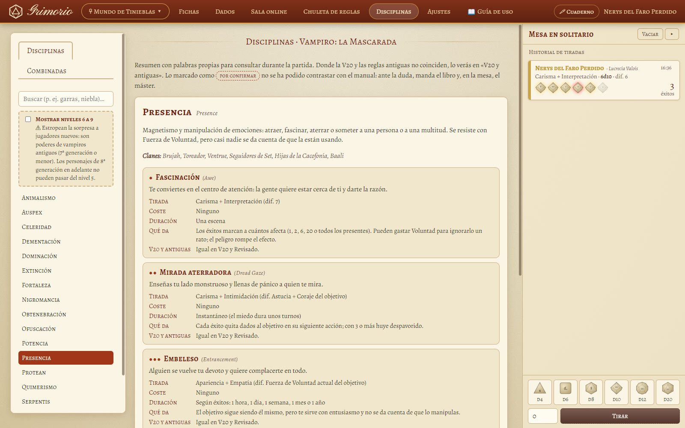
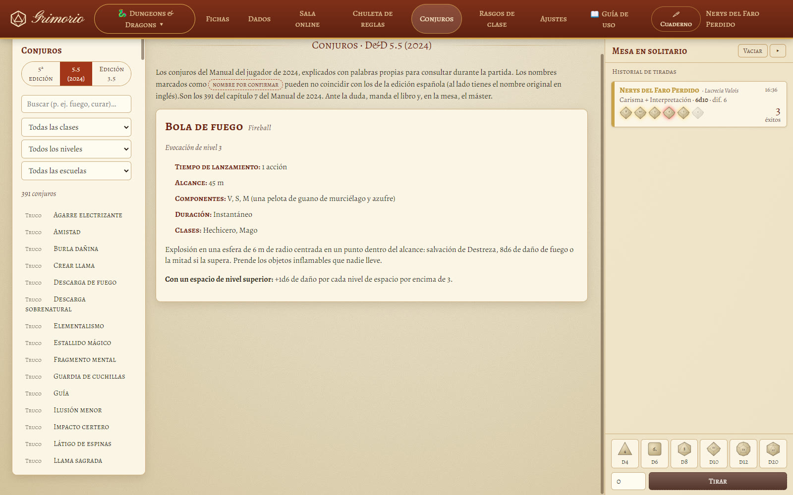

## 🕯️ Curiosidades

- Al abrir Grimorio te toca un **nombre de fantasía al azar** para la sala: «Nerys del Faro Perdido», «Halvar del Último Invierno»… Cámbialo cuando quieras (o pide otro).
- Los poderes de **niveles 6 a 9** de las disciplinas están **ocultos** para no destripar sorpresas a quien empieza.
- El generador de características de D&D **solo te deja usar los métodos oficiales** de tu edición: el resto sale tachado y te explica por qué.
- Tiene **cuaderno** de notas con aspecto de libro antiguo, para apuntar pistas, nombres y deudas de sangre.
- Donde veas un círculo con **?**, deja el ratón encima: te explica esa parte. Y la **Guía de uso** te enseña todo paso a paso.
- Funciona con las reglas **V20** y con las **antiguas** de Mundo de Tinieblas: tú eliges al crear la sala.

## ✨ Y además

| | |
|---|---|
| 🧛 **62 clanes y linajes** de Vampiro, **17 tribus** de Hombre Lobo y **27 tradiciones** de Mago | 🖼️ **Retratos**: de la galería de arquetipos, tu propia imagen o **creados con IA** |
| 📄 **Exportar a PDF** y exportar o importar fichas | ⚔️ **Tiradas de combate** de Mundo de Tinieblas: reserva, daño y absorción |
| 🗺️ **Mapa táctico** e **iniciativa** en la sala | 📱 **Versión para Android**, con las mismas fichas |
| 🗂️ **Varias fichas abiertas** a la vez, en pestañas | 💾 **Se guarda solo**, en tu PC |

## 🔒 Tus datos son tuyos

- Tus fichas se guardan **en tu PC** (en *Documentos\Grimorio*), no en ninguna nube.
- **Sin cuentas, sin publicidad, sin analítica.**
- En una sala os conectáis **directamente entre vosotros**; solo se usa un servicio público para que vuestros equipos se encuentren con el código.
- Si creas un retrato con IA, solo se envía la **descripción** que escribes a un servicio gratuito de imágenes.

## 💻 Requisitos

| | Mínimos | Recomendados |
|---|---|---|
| **🪟 Windows** | Windows 10 (64 bits), 4 GB de memoria | Windows 10 u 11 (64 bits), 8 GB |
| **📱 Android** | Android 5.1 | Android 10 o más nuevo |
| **🐧 Linux** | 64 bits (Ubuntu 22.04, Linux Mint 21, Debian 12 o similares) | Una distribución reciente |
| **Internet** | Para las salas online y los retratos con IA | Lo mismo |

## ⬇️ Descargar

Ve a **[la última versión](../../releases/latest)** y descarga la de tu sistema:

| Sistema | Archivo | |
|---|---|---|
| 🪟 **Windows 10 / 11** (64 bits) | `Grimorio.exe` | ✅ Recomendada · no se instala: se abre con doble clic |
| 📱 **Android** | `Grimorio.apk` | Las versiones nuevas se instalan encima sin perder tus fichas |
| 🐧 **Linux** | `Grimorio-Linux.AppImage` | Dale permiso de ejecución y ábrelo |

> [!NOTE]
> **¿Sale «Windows protegió su PC»?** Es normal: la aplicación no tiene un certificado de firma (cuesta dinero cada año y esto es un proyecto personal y gratuito), no porque tenga nada malo. Pulsa **«Más información» → «Ejecutar de todas formas»**.

Instrucciones paso a paso en el **[LEEME](LEEME.txt)** · Qué trae cada versión en **[NOVEDADES](NOVEDADES.md)**.

## ❓ Preguntas frecuentes

<b>¿Es gratis?</b>

Sí, del todo. Es una aplicación de fans, **gratuita y no oficial**.

<b>¿Necesito los libros?</b>

Grimorio te ayuda a llevar la ficha y a consultar las reglas rápido, con explicaciones resumidas. Para jugar a fondo, los libros siguen siendo la referencia (y en la mesa, manda el máster).

<b>¿Necesito una cuenta?</b>

No. Abres la aplicación y listo. Para jugar online solo hace falta el código de la sala.

<b>¿Cómo juego con mi grupo?</b>

Uno pulsa **Crear sala**, elige el juego y las reglas, y pasa el código de 6 letras. Los demás lo escriben en **Unirse a una sala**. El que crea la sala debe tener Grimorio abierto mientras dure la partida.

<b>¿Pierdo mis fichas al actualizar?</b>

No. Se guardan en *Documentos\Grimorio*: descarga el `Grimorio.exe` nuevo, sustituye el anterior y ahí siguen tus fichas.

---

Aquí están las **descargas** y la información pública de Grimorio; el código de la aplicación no es público.

Grimorio es una aplicación de fans, **gratuita y no oficial**, que se ofrece «tal cual». No está afiliada a Paradox Interactive ni a Wizards of the Coast.

Portions of the materials are the copyrights and trademarks of Paradox Interactive AB, and are used with permission. All rights reserved. For more information please visit worldofdarkness.com. 
This work includes material taken from the System Reference Document 5.1 ("SRD 5.1") by Wizards of the Coast LLC and available at https://dnd.wizards.com/resources/systems-reference-document. The SRD 5.1 is licensed under the Creative Commons Attribution 4.0 International License available at https://creativecommons.org/licenses/by/4.0/legalcode. Parte del material de la 3.5 procede del System Reference Document 3.5, bajo la Open Game License 1.0a. 
Dungeons & Dragons es una marca de Wizards of the Coast. Mundo de Tinieblas, Vampiro: la Mascarada, Hombre Lobo: el Apocalipsis y Mago: la Ascensión son marcas de Paradox Interactive AB.

**Un proyecto personal de JesusJacky** · 🕯️ *Que los dados te sean propicios.*

